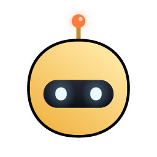

<div align="center">



# Tobi

**AI-помощник для работы и задач на Windows 11.** Живёт у верхнего края экрана и всплывает по `Ctrl+Alt+N`
(сочетание меняется в **Настройки → Сочетания клавиш**). Показывает, что делает Claude Code — думает, читает, правит,
запускает, — даёт разрешить или отклонить запрос в один клик, отвечает на вопросы агента, открывает diff в VS Code
и следит за GitHub.

</div>

## Что умеет

- **Агенты вживую** — Claude Code, Codex, Cursor, Gemini CLI, Copilot CLI, OpenCode, Amp и другие: каждый шаг сессии, правки файлов с `+N −M`, полный diff по клику.
- **Разрешения и вопросы** — Allow / Deny / Always прямо в окошке, выбор ответа на `AskUserQuestion`.
- **Перейти в терминал** — `Ctrl+Alt+T` выводит вперёд окно, где идёт сессия.
- **VS Code** — открыть изменённый файл в редакторе, VS Code как основной инструмент в активных плашках.
- **GitHub** — открытые PR, запрошенные ревью, статус CI. Плюс Vercel, Stripe, n8n, Notion, Resend, Cal.com.
- **Чат** — Claude, OpenAI, Gemini, DeepSeek, Qwen, Moonshot или локальная модель (Ollama, LM Studio), ключи в Диспетчере учётных данных Windows.
- **Файл на окошко** — Tobi превращается в коробку, «проглатывает» файл и отвечает на вопросы о нём.
- **Диктовка и заметки звонков** — офлайн-распознавание Parakeet (sherpa-onnx).
- **Лимиты Claude и Codex**, Spotify, недельная сводка, гардероб, Tobi на рабочем столе.
- **Сочетания клавиш** — все настраиваются и проверяются на конфликт с раскладками (AltGr).
- **Приватно** — без телеметрии и аккаунта, сеть только к сервисам, которые ты подключил.

## Сборка

Нужны Node 24, Rust (MSVC) и Visual Studio Build Tools с C++.

```bash
npm install
npm run tauri dev
```

Установщики: `npm run pack` → `release/`. Тесты: `npm test` и `cargo test --release --workspace`.
Иконки и звуки рисуются кодом: `npm run icons`, `npm run sounds`.

## Происхождение

Tobi — форк кода [Coucou for Windows](https://github.com/louis-cfm/coucou) (MIT, © Louis Raillé), см. [NOTICE.md](NOTICE.md).
Персонаж, иконка и звуки — свои. Лицензия: [MIT](LICENSE).
