<div align="center">



<a href="https://github.com/sailxx/Tobi/releases/latest/download/Tobi-Windows-setup.exe"></a>&nbsp;&nbsp;<a href="https://github.com/sailxx/Tobi/releases/latest/download/Tobi-Linux-x86_64.AppImage"></a>&nbsp;&nbsp;<a href="https://github.com/sailxx/Tobi/releases/latest/download/Tobi-macOS-aarch64.dmg"></a>&nbsp;&nbsp;<a href="https://github.com/sailxx/Tobi/releases/latest"></a>

**Tobi is an AI helper for working on Windows 11, Linux and macOS.** Press `Ctrl+Alt+N` and he drops in from the top of your screen to show what Claude Code is doing: thinking, reading, editing files, running commands. Allow or deny an agent’s request in one click. No telemetry, no account.

</div>

<br>



<details>
<summary><b>More about the features</b></summary>

### 🤖 Live agents

Claude Code, Codex, Cursor, Gemini CLI, Antigravity, Copilot CLI, OpenCode, Amp, Claude Desktop and more. Every step of a session shows in the window: what the agent reads, edits and runs. A file edit shows its name with `+N −M`, and a click opens the whole diff. When the task is done, Tobi does a happy little jump.

### ✅ Permissions and questions

A Claude Code permission request comes with **Allow / Deny / Always**. `AskUserQuestion` prompts show their choices right in the window, up to 4 questions at once. The card stays until you answer; fold it and come back with `Ctrl+Alt+A`.

### 🧑‍💻 Terminal and VS Code

`Ctrl+Alt+T` brings the session’s window to the front. One button in the diff opens the edited file in VS Code.

### 🔌 GitHub and services

Open PRs, review requests and CI status on GitHub, plus Vercel, Stripe, n8n, Notion, Resend, Cal.com and Spotify, each in its own colored pill with a little Tobi. Keys live in the system keystore: Windows Credential Manager, the Secret Service on Linux (GNOME Keyring, KWallet) or the Keychain on macOS.

### 💬 Chat and files

Chat with Claude, OpenAI, Gemini, DeepSeek, Qwen, Moonshot or a local model (Ollama, LM Studio) with your own key. Drop a file on the window: Tobi turns into a box, swallows it and answers questions about it.

### ✈️ Telegram, mail and WhatsApp (experimental)

Your unread chats in the island: open one to read its last messages and reply (Enter sends, Shift+Enter starts a new line); click a message to see it whole, with its photo (Telegram), and copy the text or the photo. Telegram signs in with your own account through your own API id (free, from my.telegram.org), the phone number and the code Telegram sends; Gmail signs in with your own Google OAuth client (the browser opens Google’s page), lists your unread mail, opens a message as plain text and lets you reply, write a new message, archive or delete to the bin; Any other mailbox (Yandex, Mail.ru, Yahoo, iCloud or your own server) works over IMAP with an app password; WhatsApp goes through a gateway on this computer. All are off by default, keep messages in memory only and never write them anywhere: **Settings → Integrations**.

### 🫥 Hide when idle

While Tobi has nothing to show, nothing stays at the top of the screen. `Ctrl+Alt+N` and your agents’ requests bring him out. Turn off **Settings → Hide when idle** to have him peek out when the pointer touches the top edge.

### 🎭 Character

Tobi blinks, follows your cursor, cheers, dozes off, grumbles when poked and gets dizzy if you keep going. Drag him onto the desktop, or right-click him for the wardrobe; he also dresses up for the seasons on his own. All 29 sounds are synthesized in code.

</details>

<br>



<br>



<br>



<details>
<summary><b>Install</b></summary>

**Windows 10 or 11.** Download [`Tobi-Windows-setup.exe`](https://github.com/sailxx/Tobi/releases/latest/download/Tobi-Windows-setup.exe) or [`Tobi-Windows.msi`](https://github.com/sailxx/Tobi/releases/latest/download/Tobi-Windows.msi). The installer isn’t signed yet, so SmartScreen warns you: **More info → Run anyway**.

**Linux (x86_64).** Download [`Tobi-Linux-x86_64.AppImage`](https://github.com/sailxx/Tobi/releases/latest/download/Tobi-Linux-x86_64.AppImage), `chmod +x` it and run it, or install the `.deb` / `.rpm` from the [release](https://github.com/sailxx/Tobi/releases/latest). The island sits on the top edge as a layer-shell surface on KDE, COSMIC and wlroots compositors, and through XWayland or X11 on GNOME (see [Platforms](#platforms)).

**macOS 11 or later.** Download [`Tobi-macOS-aarch64.dmg`](https://github.com/sailxx/Tobi/releases/latest/download/Tobi-macOS-aarch64.dmg) (Apple silicon) or [`Tobi-macOS-x86_64.dmg`](https://github.com/sailxx/Tobi/releases/latest/download/Tobi-macOS-x86_64.dmg) (Intel) and drag Tobi to Applications. The app is ad-hoc signed and **not notarized** (that needs a paid Apple Developer account), so macOS refuses the first launch: right-click the app and choose **Open**, or run `xattr -dr com.apple.quarantine /Applications/Tobi.app` once.

Then open Tobi (`Ctrl+Alt+N`) → **Settings → Agents** and connect Claude Code. Tobi backs up `~/.claude/settings.json` and shows the changes before writing them. The interface is in Russian by default; switch it in **Settings → Language**.

</details>

<a id="platforms"></a>

<details>
<summary><b>Platforms and known limits</b></summary>

CI builds and tests Tobi on Windows, Ubuntu and macOS for every change, and the release carries all three. **Windows is the platform Tobi is developed and used on.** Linux has been run on real desktops by its users. **The macOS build has never been run on a Mac by its author**: it compiles and its tests pass in CI, nothing more is claimed. Please open an issue for anything that looks wrong.

| | Windows | Linux | macOS |
|---|---|---|---|
| Island, click-through, eyes | cursor poll | layer-shell (KDE, COSMIC, wlroots), XWayland on GNOME, X11 | cursor poll (untested on a notch display) |
| Agent hooks | named pipe | Unix socket in `$XDG_RUNTIME_DIR` | Unix socket in `~/Library/Application Support/Tobi` |
| Secrets | Credential Manager | Secret Service | Keychain |
| Tray | notification area | tray icon (AppIndicator) | menu bar |
| Terminal / window jump (`Ctrl+Alt+T`) | yes | KWin, X11, kitty | no: opens the folder in VS Code |
| Flow dictation (hold a key) | yes | X11 and Wayland portal | no: the pill’s buttons only |
| Notetaker | mic and system sound | mic and system sound | mic only (no system-sound capture) |
| Spotify pill | yes | MPRIS | no |
| Phone link, Telegram, mail, WhatsApp, chat | yes | yes | yes (compiled; not run on a Mac) |
| In-app updates | install from the card | opens the release page | opens the release page |
| Signing | unsigned | none | ad-hoc, not notarized |

</details>

<details>
<summary><b>Development</b></summary>

Tauri 2: Rust in `src-tauri/`, TypeScript in `src/`, the agents’ hook relay in `hook/`.

```bash
npm install
npm run tauri dev                       # run with hot reload
npm run pack                            # installers in release/
npm test                                # island tests (Node)
cargo test --release --workspace        # Rust tests
```

Needs Node 24 and Rust. Windows: MSVC and Visual Studio Build Tools with C++. Linux: the GTK/WebKit packages listed in `.github/workflows/ci.yml`. macOS: Xcode command line tools. A `vX.Y.Z` tag releases; CI builds the installers on all three systems.

The icon is the logo in `assets/logo.png` (cut into `src-tauri/icons/`). The sounds and the README images are generated; don’t edit them by hand:

```bash
npm run sounds                                     # sounds/
cd tools/readme && npm install && node build.mjs   # assets/readme/
```

Tobi is based on the code of [Coucou for Windows](https://github.com/louis-cfm/coucou) (MIT, © Louis Raillé), see [NOTICE.md](NOTICE.md). The character, icon and sounds are his own. Golos Text and JetBrains Mono in the README images are under the SIL Open Font License 1.1.

</details>
